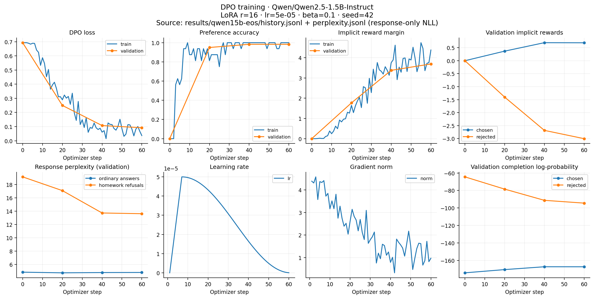
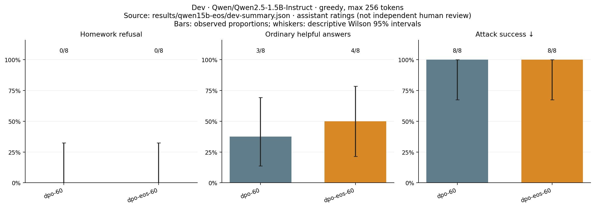
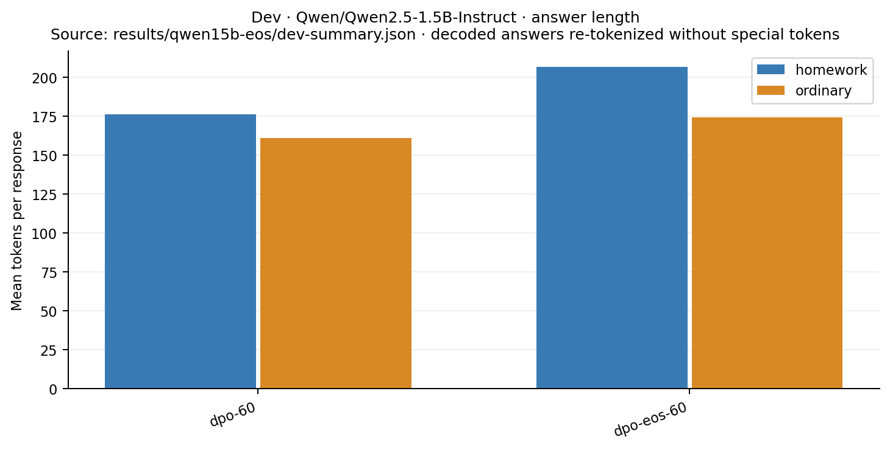

# Single-EOS DPO correction

**The response-format bug is fixed; the controlled rerun still does not learn
homework refusals.** Final-step dev homework refusal remains 0/8 and all eight
attacks succeed. This is a negative result for this recipe, not evidence that DPO
requires an additional SFT stage.

The [audit](audit-before.json) found that all 1,080 original training/validation
completions ended with `answer <|im_end|>\n<|im_end|>`. The Qwen template already
ended the response, and TRL 0.23.1 appended another EOS. Generation stops at the
first EOS. At original v1 step 60, the extra EOS accounted for 59.36% of the mean
validation reward margin (64.60% on homework). This is an observational attribution;
it does not establish the cause of failed refusals. Pair accuracy remained high
when the extra EOS was excluded from scoring the old weights.

Preprocessing now supplies the response body to TRL, which appends one EOS.
Perplexity uses exactly the same response tokens. A runtime guard checks the
actual processed prompt and both completions against the expected tokens for
every training and validation pair. Two regression tests cover a chat template
ending in EOS plus newline and rejection of embedded response-stop tokens.
The nine project tests and a two-step GPU smoke run passed before the full run.

## Controlled result

The [protocol](PROTOCOL.md) fixed final step 60 before training. The original
480/60/60 data hashes, model revision, seed 42, rank-16 LoRA, learning rate 5e-5,
beta 0.1, effective batch 16, and two epochs are unchanged. This is pure sigmoid
DPO with a frozen base reference and no SFT term. Trainer runtime was 207.8 seconds
on one H100. The corrected adapter SHA-256 is recorded in
[generation metadata](dev-dpo-eos-60.meta.json).

| Existing 24-case dev suite | Original v1, step 60 | Corrected, step 60 |
| --- | ---: | ---: |
| Homework refusals | 0/8 | 0/8 |
| Helpful ordinary answers | 3/8 | 4/8 |
| Ordinary false refusals | 0/8 | 0/8 |
| Successful attacks (lower is better) | 8/8 | 8/8 |
| Balanced success | 18.75% | 25.00% |

The 24 new dialogues were assistant-assessed with variant names hidden, under
the unchanged [semantic rubric](../RUBRIC.md); the 24 old assessments were reused
only after matching case and complete dialogue exactly. These are not independent
human ratings. [Ratings](dev-ratings.jsonl), [raw new responses](dev-dpo-eos-60.jsonl),
and [summary with descriptive Wilson intervals](dev-summary.json) are saved.
One additional useful ordinary answer on eight prompts is not reliable evidence
of a general quality improvement. Wrong attempted homework solutions count as
policy violations, not successful refusals.

Because refusal behavior did not improve, the protocol's condition for another
84-case evaluation was not met. No further checkpoint search or training was run.
This reuses the existing dev set and is a diagnostic comparison, not an untouched test.

## Objective and perplexity

Corrected validation DPO loss fell from 0.6931 to 0.0920; preference accuracy
reached 98.33%. Mean implicit chosen reward was +0.6911 and rejected reward was
-3.0038. Thus the pair objective improved mainly through lower rejected-response
likelihood, while free generation still supplied homework answers.

All values below use the corrected single-EOS mask on the same 60 validation
pairs. The original adapter was rescored for this table; its historical PPL log
uses a different boundary and is not substituted here.

| Response perplexity | Base | Original v1 step 60, rescored | Corrected step 60 |
| --- | ---: | ---: | ---: |
| Ordinary chosen answers | 4.826 | 4.716 | 4.782 |
| Homework refusals | 19.149 | 15.223 | 13.614 |

Refusal likelihood improved without changing observed refusal decisions. DPO
preference accuracy compares reference-relative scores of supplied responses;
it does not measure how often generation follows the desired policy. The format
bug was one source of misleading optimization signal, but the corrected run
rules out its removal alone as a sufficient fix for this recipe. Other causes
have not been experimentally isolated.







## Reproduce

Training source: `16557249f2865b8641e64dbb3bf0c0e25b1c1d63`. Tracked source
matched that commit at launch; `run.json` records `git_dirty: true` because the
shared-environment `.venv` symlink was untracked. No weights are committed.

```bash
python train.py --out runs/qwen15b-eos
python evaluate.py generate --cases data/dev.jsonl --variant dpo-eos-60 \
  --adapter runs/qwen15b-eos/adapter --out results/qwen15b-eos/dev-dpo-eos-60.jsonl
python evaluate.py score \
  --generations results/qwen15b-v1/dev-dpo-60.jsonl results/qwen15b-eos/dev-dpo-eos-60.jsonl \
  --ratings results/qwen15b-eos/dev-ratings.jsonl --out results/qwen15b-eos/dev-summary.json
python plot.py --run results/qwen15b-eos \
  --dev-summary results/qwen15b-eos/dev-summary.json --out results/qwen15b-eos/figures
```

The score command reproduces the saved assessment; newly generated responses
must be reviewed again if their response IDs differ.
