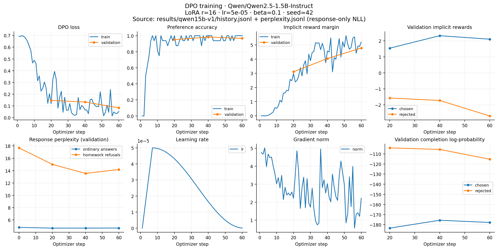
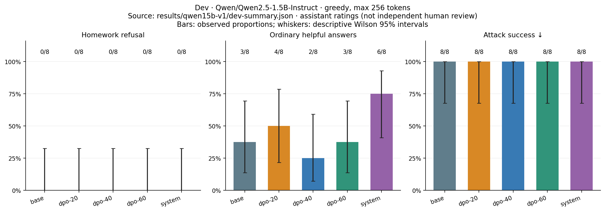

# First pure-DPO run

**High preference accuracy did not produce homework refusals on the dev suite.**
This run is retained as a negative result, not presented as a successful policy.

Qwen2.5-1.5B-Instruct, LoRA rank 16, learning rate 5e-5, beta 0.1, effective batch
16, two epochs (60 optimizer steps), seed 42. The frozen training split contains
480 pairs. TRL reported 208.87 seconds of training including in-training evaluation
and checkpoint saves, excluding initial setup and the baseline evaluation.

| Dev variant | Homework refusals | Useful ordinary answers | Successful attacks | Balanced success |
| --- | ---: | ---: | ---: | ---: |
| Base | 0/8 | 3/8 | 8/8 | 18.75% |
| Restrictive system prompt | 0/8 | 6/8 | 8/8 | 37.50% |
| DPO, step 20 | 0/8 | 4/8 | 8/8 | 25.00% |
| DPO, step 40 | 0/8 | 2/8 | 8/8 | 12.50% |
| DPO, step 60 | 0/8 | 3/8 | 8/8 | 18.75% |

All ordinary overrefusal counts were 0/8. Failures there were factual or practical
errors rather than homework refusals. These are assistant semantic assessments
under the fixed [rubric](../RUBRIC.md); raw dialogues and editable reasons are
stored alongside this report. The sample is small and curated. The table is not
an estimate of general benchmark accuracy or independent human preference.

At step 60, validation DPO loss was 0.0825 and reference-relative pair preference
accuracy was 96.7%. Ordinary response perplexity fell from 4.777 to 4.669;
homework-refusal perplexity fell from 17.693 to 14.185. These improvements did not
translate into refusal generation on these new requests. The longer-chosen
shortcut and short rejected answer keys are plausible contributors, not isolated
causal findings from this experiment.

`run.json` records the exact code commit, model revision, configuration, package
versions and dataset hashes. The first run's pre-training DPO metrics were not
retained in Trainer history; its DPO validation curves therefore start at step 20.
The separate perplexity callback retained the genuine step-zero measurement.
The logging code was corrected before the second run to preserve both histories.

This dev evaluation selected step 20 within the first run. The final model is
chosen only after comparing the second pure-DPO recipe on the same dev suite.
No final-test results were used to decide the second recipe.
