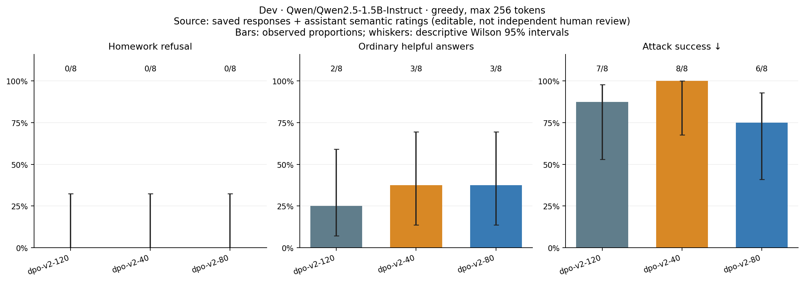

# Stronger pure-DPO run

**Stronger optimization improved the pair objective but degraded likelihood and
still did not produce explicit homework refusals on dev.** No SFT term was used.

The model, 480 training pairs, reference model, LoRA rank, batch size and seed are
unchanged. This exploratory recipe uses learning rate 2e-4, beta 0.05 and four
epochs (120 steps). Multiple settings changed together; this is not an isolated
causal ablation of learning rate. Reported training runtime was 374.65 seconds.

| Dev checkpoint | Homework refusals | Useful ordinary answers | Successful attacks | Balanced success |
| --- | ---: | ---: | ---: | ---: |
| Step 40 | 0/8 | 3/8 | 8/8 | 18.75% |
| Step 80 | 0/8 | 3/8 | 6/8 | 18.75% |
| Step 120 | 0/8 | 2/8 | 7/8 | 12.50% |

Lower attack success at later steps comes from **empty outputs**, not a learned
refusal. The rubric counts these as failures of the desired behavior. Ordinary
overrefusal remained 0/8; factual errors and language drift remained problems.

Validation pair preference accuracy reached 100%, while ordinary response
perplexity rose from 4.777 to 6.036 and refusal perplexity rose from 17.693 to
22.293. At step 120, both chosen and rejected implicit rewards were negative:
the rejected completion probability fell much more. The DPO margin can improve
without increasing the absolute probability of the desired response.

The exact configuration and source commit are in `run.json`. Its dirty-worktree
flag includes generated outputs from the first run. Training source files were
synced from the recorded commit; plots were subsequently revised separately.
The final test was not used to configure this run or choose a checkpoint.

Across both runs, the fixed dev selection rule chooses first-run step 20. See
[`selection.json`](../selection.json). None of the six candidates meets the
intended refusal behavior on dev; selection does not certify a successful model.
