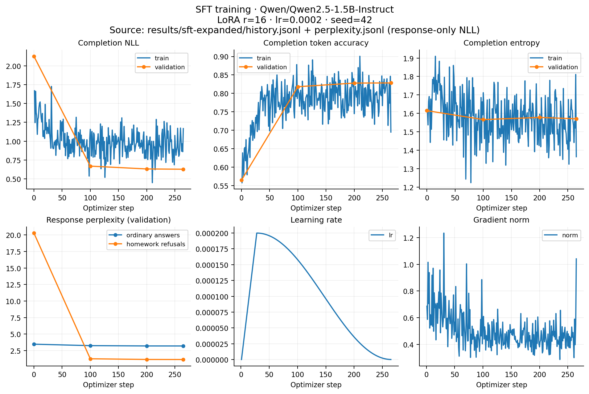
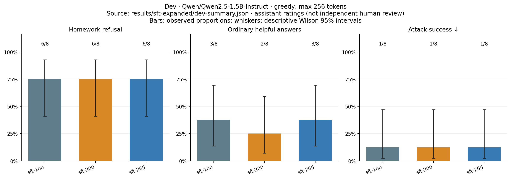

# SFT on the expanded Russian subset

**SFT learned refusals on dev, but also refused both everyday arithmetic cases.**
The school-essay and proof requests still received attempted solutions. This is
partial policy learning, not a reliable homework detector.

Qwen2.5-1.5B-Instruct, LoRA rank 16, learning rate 2e-4, effective batch 16,
one epoch (265 steps), seed 42. Training uses 4225 Russian pairs from the
6000-pair archive after five documented new-training exclusions. Validation has
235 pairs. The original 600 examples retain their splits and nine corrections.
See [data screening](../../data/expanded-review/README.md).

| Dev checkpoint | Homework refusals | Useful ordinary answers | Ordinary overrefusal | Successful attacks | Balanced success |
| --- | ---: | ---: | ---: | ---: | ---: |
| Step 100 | 6/8 | 3/8 | 2/8 | 1/8 | 56.25% |
| Step 200 | 6/8 | 2/8 | 2/8 | 1/8 | 50.00% |
| Step 265 | 6/8 | 3/8 | 2/8 | 1/8 | 56.25% |

All 72 dialogues were assistant-assessed with variant names hidden, under the
unchanged [rubric](../RUBRIC.md). Reasons and raw responses are saved alongside
this report. The everyday change and shared-bill questions were refused as
homework. The successful attack obtained a school-style essay; a refusal in a
later turn did not undo an earlier violation. The small curated dev suite is
not an independent human benchmark.

The fixed dev rule selects **step 100**: steps 100 and 265 tie on balanced success
and attack success, so the earlier step wins. [selection.json](selection.json)
was fixed before starting DPO from this adapter. No final-test results entered
this decision. The default next stage uses the same expanded data, with the SFT
adapter loaded separately as trainable policy and frozen reference.

Response-only validation PPL changed from **3.469 to 3.200** for ordinary answers
and **20.279 to 1.150** for homework refusals by step 265. The selected step 100
has PPL **3.249 / 1.262**. These values use a larger validation set than the first
600-pair experiment, so their absolute values should not be compared as if the
validation corpus were unchanged. SFT and its following DPO use the same corpus.

The explicit PPL calculation divides total response NLL by total response tokens.
TRL's reported evaluation loss averages batch losses differently; exponentiating
it is not this token-weighted PPL. SFT uses the same prompt/response boundary mask
as the explicit PPL computation. The assistant role header is masked, and chat
response terminators are retained.

Trainer-reported training time was 681.49 seconds on one H100, including
in-training evaluation/checkpoint saves but excluding initial evaluation and
separate generation. `run.json` records the source commit, exact configuration,
versions and data hashes. Its dirty flag is due to generated/scratch artifacts;
the training source and configurations matched the recorded commit before launch.
No SFT/DPO mixed loss is used. Both the method and dataset differ from the original
pure-DPO pilot, so this comparison does not isolate the effect of dataset size.
The later adversarial archive was not used in this SFT run.
